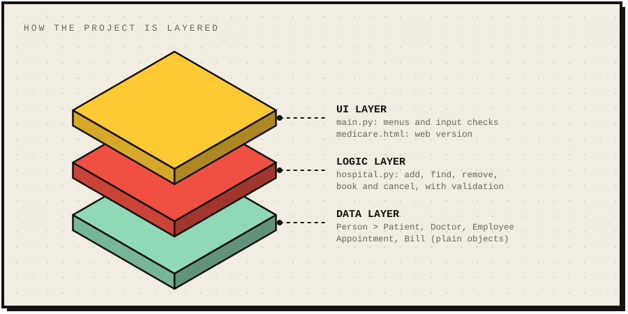
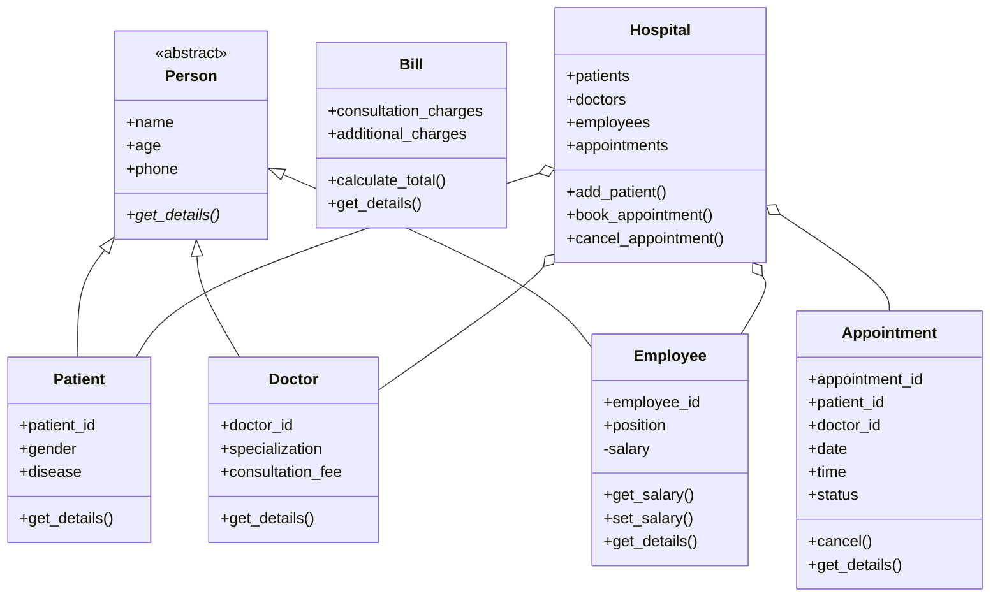

<p align="center">
  
</p>

<p align="center">
  
  
  
  
</p>

A small, beginner-friendly hospital management system built for a university **Object-Oriented Programming** project. It manages patients, doctors, appointments, employees and bills, and shows the four OOP pillars with simple, practical code.

There is **no database**. Everything is stored in Python lists inside a `Hospital` object, so the data resets when the program closes.

---

## How it is layered

<p align="center">
  
</p>

The menus never touch the lists directly. `main.py` asks `Hospital` to do the work, and `Hospital` stores plain objects (`Patient`, `Doctor`, `Employee`, `Appointment`). That is why the same classes could be reused behind a different frontend.

---

## Features

| Module | What you can do |
|---|---|
| **Patients** | Add, view all, search by ID, update, remove |
| **Doctors** | Add, view all, search by ID, remove |
| **Appointments** | Book (patient and doctor must exist), view all, search by patient ID, cancel |
| **Employees** | Add, view all, search by ID, change salary |
| **Billing** | Consultation + additional charges, total calculated, negative values rejected |

Extra rules: IDs are generated automatically and are unique inside each category, a doctor cannot be booked twice at the same date and time, and all input is validated with clear error messages.

---

## The four OOP pillars

| Pillar | File | How it is used |
|---|---|---|
| **Encapsulation** | `employee.py` | The salary is private (`__salary`). It can only be read with `get_salary()` and changed with `set_salary()`, which rejects negative values. |
| **Inheritance** | `patient.py`, `doctor.py`, `employee.py` | All three extend `Person` and reuse its `name`, `age` and `phone`. |
| **Polymorphism** | every class | Each class has its own `get_details()`. `main.py` calls the same method on any object and each one prints its own information. |
| **Abstraction** | `person.py` | `Person` uses `ABC` and `@abstractmethod get_details()`. Child classes must implement it, so a plain `Person` can never be created. |

### Class diagram



---

## Project structure

```
OOP-project/
├── main.py            # menus and program loop
├── person.py          # abstract base class Person
├── patient.py         # Patient(Person)
├── doctor.py          # Doctor(Person)
├── employee.py        # Employee(Person) with private salary
├── appointment.py     # Appointment
├── hospital.py        # Hospital: the lists and the rules
├── billing.py         # Bill
├── medicare.html      # optional web frontend (HTML, CSS, JavaScript)
├── favicon.svg        # logo
└── assets/
    ├── banner.svg         # animated 3D banner (rotating cross)
    └── architecture.svg   # isometric layer diagram
```

---

## How to run

**Command-line version (main project)**

```bash
git clone https://github.com/mawiya-47/OOP-project.git
cd OOP-project
python main.py
```

No packages need to be installed. The menu looks like this:

```
========== MEDICARE HOSPITAL MANAGEMENT ==========

1. Patient Management
2. Doctor Management
3. Appointment Management
4. Employee Management
5. Billing System
6. Exit

==================================================
```

**Web frontend (optional)**

Open `medicare.html` in any browser. It has the same modules and the same OOP classes written in JavaScript, plus a small 3D hero built with [three.js](https://threejs.org/). The 3D part and the fonts load from the internet; without a connection the page still works, just without them.

> The web page is a separate frontend. It does not call the Python files. Both follow the same design.

---

## Notes

- Data lives in memory only and is lost when the program (or the web page) closes.
- IDs start at 1 and are never reused after a record is removed.
- Removing a patient or doctor cancels their booked appointments.

Made by [@mawiya-47](https://github.com/mawiya-47)
